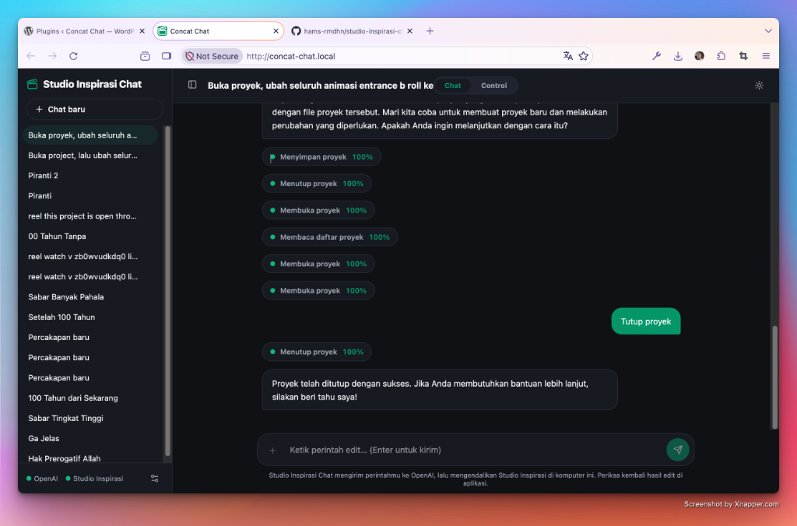

# Studio Inspirasi Chat



WordPress theme yang mengendalikan **Studio Inspirasi** (video editor desktop)
lewat percakapan natural-language + form Control deterministik. Dibangun di
atas OpenAI function calling dan JSON-RPC automation API milik Studio Inspirasi.

## Fitur

- **Chat mode** — perintah bebas ("potong segmen 2:30–3:00, ekspor") lewat AI + tools
- **Control mode** — pipeline deterministik: template → ganti video → trim segmen → caption → serah/ekspor
- **Multi-segmen** — satu run = banyak proyek `{judul}-001`, `-002`, …
- **Momen Terbaik (AI)** — dari URL YouTube: unduh video+caption+metadata, AI memilih
  N momen terbaik → satu proyek per momen, snap ke batas kalimat
- **YouTube** — unduh video + auto-caption via yt-dlp (bundled), konversi VTT→SRT terdedup
- **Caption** — style diwarisi dari template, animasi `captionMotion` terbawa,
  satu lane `Captions` rapi

## Struktur workspace (otomatis dibuat saat tema aktif)

```
~/concat-chat-projects/
├── Assets/      yt-{id}/, src-{slug}/  — material sumber
├── Projects/    proyek Studio Inspirasi (+_archive/)
├── Exported/    hasil render (flat)
└── _tmp/        file sementara/debug
```

## Instalasi (LocalWP / WordPress)

1. Salin folder tema ke `wp-content/themes/studio-inspirasi-chat`
2. Aktifkan tema di WP Admin — folder workspace otomatis dibuat
3. Buka **Studio Inspirasi** → Settings › Automation › aktifkan
   "Scripts and apps" (token di `automation.json` terbaca otomatis)
4. Isi API key OpenAI di **Studio Inspirasi Chat → Settings**
5. Jalankan — `bin/` berisi `yt-dlp` + `ffmpeg` statis (tidak perlu install)

## Keamanan

- API key OpenAI disimpan terenkripsi (AES-256-CTR)
- UI hanya untuk admin (`manage_options`)
- Automation API hanya diizinkan menulis di bawah home folder

## Binary

`bin/yt-dlp` (public domain) dan `bin/ffmpeg` (GPL — static build
martin-riedl.de). Lisensi ffmpeg: `LICENSE` + sumber di
https://ffmpeg.org/download.html
